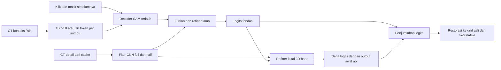

# Riset dan rencana eksperimen FSDP 3D

Tanggal: 24 November 2026. Status: kontrol dan eksperimen P1/P2/P3 sudah diimplementasikan dalam pipeline kedua; belum dijalankan di DGX dari workspace lokal. Diagnostik P0 dan opsi P4 tetap merupakan agenda lanjutan. Run resolusi DGX yang aktif tetap memakai kode dan konfigurasi semula. Sasaran utama adalah Dice segmentasi pada grid asli, bukan voxel accuracy yang mudah didominasi background.

## Keputusan utama

Pertahankan fondasi SAM-Med3D Turbo + refiner CNN, ROI fisik, cache target asli, dan lima klik per sisi. Selesaikan perbandingan resolusi yang sedang berjalan. Setelah itu, prioritaskan eksperimen informasi klik dan objective batas sebelum memperbesar encoder lagi. Semua usulan berikut adalah hipotesis yang perlu diuji pada FSDP; hasil paper pada organ, lesi, atau citra 2D tidak menetapkan bahwa FSDP kita akan mencapai Dice80%.

## Bukti dari proyek sendiri

Data terbaru yang tersedia adalah log baseline, bukan hasil akhir empat varian:

- Fondasi: Dice train49,9968%, validasi45,6332%, threshold0,35 yang dipilih dari train. Kontrol validasi threshold0,5 adalah43,0831%.
- Tambahan epoch10: Dice train53,9138%, validasi46,3681%, threshold0,5. Selisih train–validasi7,5457 poin persentase.
- Tambahan epoch15: Dice train54,4694%, validasi45,9556%, threshold0,4. Kontrol threshold0,5 adalah45,0009%.
- Peningkatan terbaik terhadap protokol threshold terkalibrasi fondasi adalah0,7349 poin persentase. Pada threshold0,5 yang sama, peningkatannya3,2850 poin. Keduanya menjawab perbandingan berbeda; jangan memilih salah satunya untuk membesar-besarkan hasil.
- Setiap epoch mencatat14/14optimizer updates dan0AMPskip. Ini membuktikan langkah optimizer tercatat, bukan bahwa semua fitur sudah optimal.
- Epoch total45 adalah30epoch sumber +15epoch tambahan dari batas100tambahan. Belum setengah run tambahan.

Train sendiri belum tinggi. Karena itu, tidak cukup bukti untuk menyalahkan generalisasi, dataset, jumlah epoch, atau embedding sebagai satu-satunya penyebab. Ada kenaikan gap, tetapi log sampai epoch15 tidak menetapkan diagnosis overfitting tunggal.

Skor memakai54pasien train,10validasi,20test yang belum dibaca; dua sisi setiap pasien berada pada split yang sama. ROI dibantu GT dan klik koreksi memakai GT. Hasil ini bukan segmentasi otomatis seluruh CT. Angka sekitar80% dari diagnostik dua pasien train tidak menjadi bukti80%validasi.

## Audit arsitektur dan recipe saat ini

Kode ditinjau pada commit14e6ecc:

1. [Jalur CNN dan residual](https://github.com/MuhammadAliffandy/fsdp-train/blob/14e6ecc/scripts/sam_refine32.py#L32): stem full-resolution8kanal, half-resolution16kanal, fusion32³, skip half/full, dan residual logits. Jadi model sudah memiliki skip resolusi tinggi; usulan berikut tidak boleh mengklaim baru menambahkan skip yang sebelumnya tidak ada.
2. [Prompt dan sampler](https://github.com/MuhammadAliffandy/fsdp-train/blob/14e6ecc/scripts/sam_refine32.py#L83): SAM menerima titik terakhir dan mask sebelumnya, sedangkan Gaussian point maps CNN menggunakan seluruh riwayat klik. Titik koreksi dipilih uniform dari voxel salah yang valid. Ini pilihan desain, belum terbukti bug atau penyebab kegagalan.
3. [Loss interaksi](https://github.com/MuhammadAliffandy/fsdp-train/blob/14e6ecc/scripts/sam_refine32.py#L112): squared DiceCE FP32 pada refined detail +0,25kali loss auxiliary konteks SAM, dirata-ratakan sepanjang lima interaksi. Sudah ada auxiliary supervision; local boundary/deep supervision adalah penambahan berbeda.
4. [Parameter aktif](https://github.com/MuhammadAliffandy/fsdp-train/blob/14e6ecc/scripts/train_sam_refine32.py#L246): image encoder blocks10/11, mask decoder dan CNN. Sepuluh blok awal, patch projection, prompt encoder dan neck dibekukan.
5. [Augmentasi](https://github.com/MuhammadAliffandy/fsdp-train/blob/14e6ecc/scripts/sam_refine_data.py#L47): refleksi LR bersama serta gain/shift intensitas bersama. Belum ada jitter ROI fisik.

Detail ROI96×160×208pada0,25mm mencakup24×40×52mm. Fusion32³berarti jarak pusat sel sekitar0,75×1,25×1,625mm. Native-half48×80×104berarti0,5mm pada tiap sumbu. Output tetap grid detail0,25mm; ukuran fusion bukan resolusi output atau batas matematis Dice.

Konteks52mm dengan token8³memiliki jarak token6,5mm; token16³menjadi3,25mm. Peningkatan token512→4096adalah8kali; matriks attention global per head dapat menjadi64kali lebih besar. Itu bukan prediksi64kali runtime seluruh model, karena ada komponen lain dan window attention. Memperbesar token juga tidak mengembalikan detail yang tidak terekam pada CT sumber.

## Temuan riset yang relevan

### 1. Global context dan local refinement

[SegVol, NeurIPS2024](https://arxiv.org/abs/2311.13385) memakai zoom-out/zoom-in untuk menggabungkan konteks volumetrik dengan analisis ROI asli. Ini mendukung pengujian detail lokal lebih rapat, tetapi bukan bukti bahwa setiap peningkatan ukuran grid menaikkan skor. Proyek kita sudah memiliki dua pandangan fisik; memakai prinsip ini tidak memerlukan mengganti task atau decoder dengan head multiclass baru.

[H-SAM, CVPR2024](https://arxiv.org/abs/2403.18271) menggunakan mask prior dan hierarchical decoding untuk detail lokal pada adaptasi medis 2D. Implikasi untuk kita adalah hipotesis fusi yang dipandu mask, bukan memindahkan angka keberhasilan multi-organ2D ke FSDP3D.

### 2. Kualitas interaksi perlu diuji

[Kode resmi SAM-Med3D](https://github.com/uni-medical/SAM-Med3D/blob/main/train.py) menyediakan opsi multi_click; defaultnya tidak mengakumulasi seluruh titik ke prompt encoder. Maka penggunaan titik terakhir pada fondasi bukan kesalahan yang otomatis harus diperbaiki.

[Implementasi resmi SAM2](https://github.com/facebookresearch/sam2/blob/main/sam2/modeling/sam2_utils.py) memuat sampler uniform dan sampler pusat error berdasarkan distance transform. Implementasinya2D; mengadaptasinya ke3D dengan jarak fisik adalah eksperimen baru. Referensi [RITM](https://arxiv.org/abs/2102.06583) juga mendukung pentingnya mask feedback dan recipe interaksi. Keuntungan dari oracle yang lebih informatif harus dipisahkan dari keuntungan arsitektur.

### 3. Loss batas dan ketidakseimbangan

[Boundary loss, MIDL2019](https://proceedings.mlr.press/v102/kervadec19a.html) menggabungkan informasi batas dengan regional loss pada segmentasi sangat tidak seimbang. Relevansinya untuk FSDP adalah pelatihan batas objek kecil; studi sumber memakai lesi, bukan FSDP. Pertahankan DiceCE dan uji komponen batas kecil secara terpisah.

[Tversky loss](https://arxiv.org/abs/1706.05721) menawarkan pengaturan trade-off FP/FN. Jangan otomatis memberi penalti FN lebih tinggi: pada fondasi precision43,72%dan recall49,66%, kedua jenis error masih penting. Pilihan bobot harus didasarkan pada audit train per kasus, bukan mengejar angka validasi.

### 4. CNN lokal yang lebih kuat dan pembanding yang benar

[MedNeXt, MICCAI2023](https://arxiv.org/abs/2303.09975) meneliti encoder-decoder3D dengan blok residual dan kernel besar. [Implementasi resminya](https://github.com/MIC-DKFZ/MedNeXt) juga mendukung penggunaan blok secara terpisah. Ini memberikan dasar untuk refiner lokal kecil, bukan alasan membuang seluruh hybrid yang telah belajar.

[nnU-Net Revisited](https://arxiv.org/abs/2404.09556) menekankan baseline, recipe dan anggaran komputasi yang sebanding. [Preset resmi ResEnc](https://github.com/MIC-DKFZ/nnUNet/blob/master/documentation/resenc_presets.md) menjadi pembanding CNN yang layak jika diperlukan. MONAI U-Net sederhana yang pernah kita latih tidak sama dengan baseline nnU-Net yang dikonfigurasi lengkap. Pembanding tanpa klik tetap merupakan task/protocol berbeda.

### 5. Topologi bersyarat

[clDice, CVPR2021](https://openaccess.thecvf.com/content/CVPR2021/html/Shit_clDice_-_A_Novel_Topology-Preserving_Loss_Function_for_Tubular_Structure_CVPR_2021_paper.html) ditujukan pada struktur tubular/network dan konektivitas. Gunakan hanya jika pakar mengonfirmasi bahwa target FSDP memang harus membentuk jalur tersambung. Nama drainage pathway saja tidak cukup. Jangan memaksa jembatan antar komponen anotasi atau menghaluskan GT agar lebih mudah dipelajari.

## Eksperimen prioritas

### P0. Diagnostik tanpa training tambahan

Setelah checkpoint tersedia, catat skor native tiap klik1–5, FP/FN, precision/recall, volume prediction/GT, duplicate clicks dan pola penurunan sesudah klik. Ukur norma serta arah gradien loss refined versus auxiliary konteks pada subset train yang ditentukan dengan seed. Ini menguji apakah interaksi atau auxiliary objective saling mengganggu; nilai auxiliary0,25sendiri bukan bukti konflik.

Pada train saja, uji sampler pusat error3D terhadap uniform dengan bobot model tetap. Gunakan lima klik per sisi, seed/tie-breaking tetap dan jarak distance transform dalam mm. Prediksi berbeda menghasilkan klik adaptive berbeda; ini perbandingan policy, bukan input koordinat yang identik. Recorded-prompt replay dapat dipakai sebagai diagnostik tambahan untuk mengisolasi respons model.

### P1. Riwayat semua klik ke SAM

Bandingkan titik terakhir versus seluruh titik1…k pada prompt encoder. CNN maps, previous mask, sampler uniform, coordinate convention, ROI, loss dan budget tetap. Tidak ada parameter decoder yang diganti. Latih dan evaluasi dengan policy yang sama. Pada satu klik, hasil awal harus identik dengan fondasi. Pada lima klik, perubahan output tanpa training dicatat sebagai perubahan input/protocol, bukan hasil learning.

Ini prioritas awal karena mengubah informasi prompt tanpa memperbesar encoder. Belum ada bukti manfaat pada FSDP kita.

### P2. DiceCE ditambah boundary term

Pertahankan supervised refined loss sekarang dan auxiliary0,25. Tambahkan satu term signed-distance boundary berbobot awal0,05, dengan jarak fisik dinormalisasi/clipping yang dibekukan dari train. Angka0,05adalah nilai awal eksperimen kita, bukan resep universal dari paper. Padding harus dikeluarkan dari loss dan pembentukan jarak agar batas padding tidak menjadi target anatomi.

Bandingkan dengan kontrol tanpa term tersebut. Jangan mengganti DiceCE, mengubah FP/FN weighting dan memperbesar ROI dalam run yang sama. Jika audit gradien memperlihatkan konflik auxiliary, uji0,25→0,10pada eksperimen terpisah; jangan langsung menghapus auxiliary yang ikut melatih fondasi.

### P3. Refiner residual3D yang mempertahankan fondasi

Untuk pipeline paralel, resolusi ditetapkan sebelumnya pada fondasi8³token/CNN32³, sehingga tidak perlu menunggu atau memilih pemenang dari matriks resolusi aktif. Tambahkan branch residual lokal pada fitur native-half, dengan depthwise Conv3D5³, pointwise channel mixing dan masukan mask prior/point maps. Pertahankan stem, skip, encoder, prompt encoder, mask decoder dan refiner lama. Penggabungan dengan kandidat resolusi lain memerlukan tahap konfirmasi berikutnya.

Inisialisasikan proyeksi output branch baru ke nol sehingga prediksi awal persis sama dengan checkpoint sumber. Pastikan gradien proyeksi baru hidup; jangan membuat semua jalur baru menjadi nol dan tidak dapat belajar. Metrik native, full-target retention dan five-click budget tetap. Uji tambahan local-half deep supervision sebagai eksperimen berbeda, karena fondasi sudah punya global-context auxiliary loss.

Ini adaptasi ide, bukan implementasi H-SAM atau MedNeXt penuh. Parameter/VRAM/latensi aktual harus diukur di DGX. Tidak ada estimasi persen kenaikan yang sah sebelum eksperimen.

Skema kandidat P3; semua jalur lama tetap dipertahankan:

### P4. Baru perluas adaptasi encoder atau augmentasi

Jika train masih sulit fit, bandingkan blok8/9/10/11aktif terhadap10/11pada learning rate SAM yang sama; jangan sekaligus menaikkan LR dan grid. Adapter kecil adalah opsi berikutnya, bukan keharusan. Lebih sedikit parameter trainable tidak otomatis membuat attention lebih cepat.

Jika train naik tetapi validasi tertinggal, prioritaskan jitter ROI fisik ringan, misalnya maksimum1mm per sumbu yang dibatasi margin train agar seluruh target tetap masuk. CT, label dan support pada detail/context harus memakai transform fisik yang sama. Evaluasi tetap ROI frozen; cache sumber tidak ditimpa. Hindari elastic distortion agresif dan penambahan target dari folder ahli tanpa mapping yang valid.

## Anggaran dan kriteria memilih eksperimen

Biarkan baseline/detail/tokens/combined yang sudah aktif berjalan. Jangan mengubah script yang sedang dipakai parent workflow karena ada pemeriksaan checksum antar child. Implementasi paralel memakai file baru dengan channel logs/output terpisah, guard GPU idle, dan satu UUID GPU terlihat pada setiap child. Kedua pipeline berjalan bersamaan, sedangkan empat arm riset bergiliran di GPU kedua.

Untuk screening berikutnya, bandingkan kontrol, P1, P2 dan P3 secara terpisah. Masing-masing mulai dari checkpoint fondasi yang sama,54/10split yang sama dan batas20epoch tambahan atau280optimizer updates pada accumulation8. Nilai ini adalah anggaran screening, bukan definisi konvergensi. Kontrol20epoch memiliki jadwal cosine yang sama dengan arm riset; kontrol100epoch dari pipeline resolusi bukan penggantinya. Satu seed untuk screening; kandidat yang menjanjikan dikonfirmasi dengan seed kedua. Jangan menghentikan kandidat hanya karena turun sesaat di epoch5atau mempromosikan model berdasarkan tiny train Dice.

Primary metric tetap patient-macro bilateral Dice native@5per sisi; laporkan juga@1, per-side, median/worst case, FP/FN dan threshold0,5kontrol. Threshold operasional dipilih hanya dari train. Tambahkan HD95 dalam mm dan surface Dice pada toleransi yang ditetapkan sebelum evaluasi, misalnya0,5dan1mm untuk diagnostik, bukan batas penerimaan klinis. Definisikan perlakuan prediksi kosong dan jangan menghapus kasus gagal dari rata-rata.

Pilih kandidat berdasarkan selisih berpasangan per pasien, konsistensi seed, dan biaya GPU. Rekam wall-clock training serta evaluasi, peak VRAM, optimizer updates, waktu mencapai Dice50%/60%jika tercapai, dan tidak-tercapai jika memang tidak. Jangan menganggap satu epoch paper setara satu epoch108ROI kita. Tolak kandidat yang hanya meningkatkan train, hanya memperbaiki rata-rata dengan kasus lain runtuh, atau mengubah klik/ROI tanpa melabeli perubahan protokol.

Sepuluh pasien validasi sudah sering dilihat sehingga hasilnya eksploratif. Konfirmasi formal dapat memakai fold pasien di54train; preprocessing/normalisasi/agregat ROI harus dihitung dari inner-train tiap fold, bukan memakai cache54pasien sebagai preprocessing fold yang dianggap bebas leakage. Cache native target terverifikasi dapat menjadi sumber target rekonstruksi. Evaluasi akhir20test menunggu pemulihan anotasi test dan protokol yang dibekukan.

## Keterbatasan anotasi dan kesimpulan operasional

labelsTr/ColorTable asli saat ini kosong, tetapi cache1/9train/val telah lolos checksum dan pemeriksaan foreground. Ini menjaga target lama, bukan memvalidasi anatominya ulang. Audit lama labels_exp1/2/3 menunjukkan mapping bukan1/9dan tidak menyediakan agreement FSDP yang sah. Jangan membuat consensus dari folder tersebut atau memakai angka raw-label82%sebagai model Dice.

Saran landmark dari client tetap masuk agenda lanjutan: posisi landmark dan hubungan ke struktur sekitar memerlukan definisi serta referensi pakar. Landmark harus dinilai dengan error posisi dalam mm; hasil tersebut tidak boleh disebut Dice FSDP. Full17class anatomical auxiliary training memerlukan pemulihan anotasi yang saat ini tidak ada. Tahap cepat berikutnya masih dapat memakai target binary cache yang sudah terverifikasi.

Keputusan berikutnya adalah tiga pengujian kecil dan terukur: informasi klik, loss batas, lalu residual refiner3D. Memperbesar token tetap diuji melalui matriks aktif. Tidak ada sumber yang ditinjau di sini yang membuktikan80%Dice dapat dicapai pada definisi FSDP dan split privat ini. Ukuran model adalah salah satu variabel; target, supervision, interaksi, recipe dan evaluasi menentukan apakah kenaikan itu nyata.
