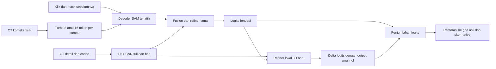

# Riset dan rencana eksperimen FSDP 3D

Tanggal: 24 November 2026. Status: kontrol dan eksperimen P1/P2/P3 sudah diimplementasikan dalam pipeline kedua; belum dijalankan di DGX dari workspace lokal. Diagnostik P0 dan opsi P4 tetap merupakan agenda lanjutan. Run resolusi DGX yang aktif tetap memakai kode dan konfigurasi semula. Sasaran utama adalah Dice segmentasi pada grid asli, bukan voxel accuracy yang mudah didominasi background.

## Pembaruan 25 November: bukti setelah screening dan kelanjutan history

Bagian24November di bawah adalah catatan keputusan saat itu. Hasil DGX terbaru: control47,75%, history49,18%, boundary47,51%, refiner47,20%validation Dice@5per sisi setelah masing-masing20epoch tambahan. History unggul1,43poin terhadap kontrol screening yang sebanding. Baseline resolution selesai dengan46,51%; detail baru3epoch, tokens/combined belum punya hasil training selesai. SIGTERM menghambat resolution; pengirimnya belum teridentifikasi. Kegagalan proses bukan bukti ketidakmampuan arsitektur tersebut.

Kelanjutan dari history terbaik selesai25/100tambahan dengan early stopping dan best_epoch0. Tidak ada evaluasi berkala yang melampaui sumber49,1836%. Checkpoint terpilih memiliki frozen train53,0151%dan val49,1836%; ini bukan skor train terakhir dari epoch25. Kurva1–25yang kemudian diterima menunjukkan train meningkat sementara val menurun; rinciannya tercatat di bawah. Menambah epoch dengan recipe lanjutan tersebut belum menunjukkan manfaat, tetapi tidak menetapkan bahwa semua LR atau adaptasi encoder gagal.

Kontrol threshold0,5memberi48,6520%, hanya0,5316poin di bawah threshold train0,45. Recall rata-rata56,42%dan precision44,85%menunjukkan bahwa target yang hilang dan prediksi berlebih perlu diperiksa bersama; Dice tidak boleh dihitung ulang sebagai harmonic mean dari kedua rata-rata itu. Surface Dice1mm87,7895%dan0,5mm77,9309%adalah metrik toleransi batas, bukan volumetric Dice80–90%. Jarak permukaan yang relatif dekat adalah petunjuk untuk menguji sensitivitas batas objek tipis, bukan bukti offset registrasi seragam atau anotasi salah.

### Langkah sekarang: audit artifact tanpa training tambahan

`inspect_fsdp_bottleneck.py` memakai stdlib untuk membaca summary/history/patient CSV/config. Tidak ada bobot, citra, cache tensor, GPU atau test image yang dibaca; source artifacts tidak ditulis. Audit memisahkan epoch0, checkpoint terpilih, dan frozen inference pada epoch terakhir yang diukur. Hitungan TP/FP/FN diverifikasi terhadap Dice masing-masing pasien, begitu pula rerata CSV terhadap summary. Original screening history/control dibandingkan berpasangan hanya jika cache/manifest/foundation/physical policy/versions/recipe sama. Anggaran screening20epoch tidak dianggap sebagai kontrol sebanding untuk kelanjutan100epoch.

```bash
cd ~/raid/Clara/fsdp-train && git pull --ff-only origin main && \
python scripts/inspect_fsdp_bottleneck.py --run-dir outputs/private/fsdp_research/latest
```

Laporan memuat kurva train/val dan LR, gap terpilih versus gap akhir, kesalahan dan rasio volume per pasien, keuntungan klik1→5, efek threshold, geometri fitur serta jumlah pasien yang membaik/memburuk terhadap kontrol screening. Flag pola menggunakan ambang deskriptif dan bukan uji statistik atau pemicu training otomatis. Output audit DGX sudah diterima dan dirangkum berikut; hasil tes sintetik tidak menjadi temuan klinis.

### Hasil audit diterima: satu ablation augmentasi fisik

Audit DGX menunjukkan frozen train53,0151→55,7629%dan val49,1836→45,2509%; gap naik3,83→10,51poin. Ini konsisten dengan overfitting pada recipe tersebut, bukan bukti penyebab tunggal. Pada source terpilih, val_02memiliki917voxel prediksi versus875GTtetapi Dice37,28%: volume hampir sama tetap bisa memiliki overlap buruk. train_53memiliki rasio volume3,344dan Dice24,65%; tinjau overlay/definisi bersama anotator, jangan buang kasus dari skor.

Implementasi berikutnya hanya menambahkan translasi fisik train: peluang50%, maksimum1mm per sumbu, integer voxel detail, CT/target/support detail dan context bergeser dalam mm yang sama. Target harus utuh dan berada di support; transform tidak aman dibatalkan untuk kedua view. Ini bekerja dalam FOVcache yang ada, bukan recrop yang memperoleh anatomi di luarnya. Seed augmentasi independen dari urutan sampel, augmentasi light dan oracle click RNG yang lama. Inferensi tanpa criterion meneruskan langsung ke history lama; evaluasi native tetap identik.

Sumber tetap history best49,1836%dari screening. Kontrol sebanding adalah kelanjutan yang baru selesai25/100(bestepoch0), dengan source/LRmultiplier0,1/cap100/patience25/seed/loss/klik/ROI/eval sama. Config, versi, implementasi model/data, identitas source dan checksum kontrol wajib cocok. Run baru mempertahankan source sebagai kandidat epoch0, mencatat jumlah translasi/penolakan tiap epoch dan delta terhadap kontrol tersebut. Arsitektur8³/32³dengan full/half skips tetap; ini menguji generalisasi tanpa sekaligus mengganti loss atau memperbesar encoder. Lihat launcher `scripts/launch_fsdp_history_jitter_nohup.sh` di README. Belum ada hasil GPU untuk augmentasi ini.

### Keputusan eksperimen lanjutan bersyarat pada hasil

1. Jika frozen train terus meningkat tetapi val menurun, uji satu perubahan generalisasi: jitter ROI fisik ringan yang dipasangkan pada CT/GT/context/support dan menjaga target utuh, sementara arsitektur/source/loss tetap. Evaluasi tetap memakai ROI frozen. Tinjau overlay kasus train yang paling salah bersama anotator untuk konsistensi definisi; perubahan anotasi harus terversi dan dibekukan, bukan diedit per kasus demi menaikkan validasi.
2. Jika train dan val sama-sama sulit meningkat, ulangi tiny-fit pada2pasien train menggunakan persis history49,18%, physical cache dan scoring native saat ini. Nonaktifkan augmentasi pada diagnosis; target90%hanya gerbang memorisasi train, bukan klaim90%validasi. Jika masih gagal, ukur komponen gradien refined versus auxiliary0,25pada parameter SAM yang dipakai bersama; penurunan auxiliary atau perubahan Dice/Tversky baru diuji jika ada bukti arah/norma gradien bermasalah.
3. Selesaikan tokens16³ dan native-half detail dari studi resolution dengan recipe asal. Model sudah punya full/half skip; fusion32³bukan batas resolusi output. Pembesaran grid adalah hipotesis yang sedang diuji. [SegVol](https://arxiv.org/abs/2311.13385) mendukung kombinasi konteks dan ROI lokal, tetapi proyek ini sudah memiliki dua pandangan; paper itu tidak menetapkan kenaikan40poin pada FSDP ini.
4. Jika tiny-fit/gradien/geometry sehat tetapi fit cohort masih rendah, uji encoder blocks8–11versus10–11dari source history yang sama pada LR/budget yang sebanding. Ini usulan belum diimplementasikan, bukan janji bahwa lebih banyak parameter akan membantu. Sampler pusat error dalam mm versus uniform juga merupakan policy ablation terpisah; anggaran klik tetap dan kenaikan oracle harus dilabeli dengan benar.
5. Sebagai pembanding kemudian, gunakan recipe3D CNN yang dikonfigurasi dengan benar, bukan menyebut U-Net sederhana lama sebagai nnU-Net. Cohort U-Net lama mencatat train32,50%/val18,64%dengan preprocessing yang berbeda. [nnU-Net Revisited](https://arxiv.org/abs/2404.09556) mendukung pentingnya baseline/configuration dan anggaran yang sebanding; tidak menjanjikan80%pada FSDP. Pembanding tanpa klik tetap berbeda dari interactive SAM.

Target dari49,18%ke80%masih berjarak30,82poin; tambahan40poin berarti89,18%. Belum ada eksperimen pada definisi target/split ini yang membuktikan kenaikan tersebut dapat dicapai. Tiga folder ahli belum memberikan agreement untuk target FSDP yang terpetakan sama; jangan memakai angka raw-label lama sebagai batas kualitas anotasi. Kurva, audit kesalahan, uji resolusi dan peninjauan anotasi diperlukan untuk menentukan investasi berikutnya.

Sepuluh pasien validasi yang sudah sering dipakai adalah eksploratif. Jika membuat fold konfirmasi di54train, checkpoint49,18%sudah pernah melihat seluruh54pasien sehingga tidak sah untuk menginisialisasi evaluasi held-out fold itu. Mulai fold dari Turbo eksternal dan hitung preprocessing hanya dari inner-train; cache native target yang terverifikasi dapat menjadi sumber target. Test20pasien tetap tidak dibaca dan evaluasi final menunggu anotasi test tersedia serta protokol dibekukan.

## Keputusan utama

Pertahankan fondasi SAM-Med3D Turbo + refiner CNN, ROI fisik, cache target asli, dan lima klik per sisi. Selesaikan perbandingan resolusi yang sedang berjalan. Setelah itu, prioritaskan eksperimen informasi klik dan objective batas sebelum memperbesar encoder lagi. Semua usulan berikut adalah hipotesis yang perlu diuji pada FSDP; hasil paper pada organ, lesi, atau citra 2D tidak menetapkan bahwa FSDP kita akan mencapai Dice80%.

## Bukti dari proyek sendiri

Data terbaru yang tersedia adalah log baseline, bukan hasil akhir empat varian:

- Fondasi: Dice train49,9968%, validasi45,6332%, threshold0,35 yang dipilih dari train. Kontrol validasi threshold0,5 adalah43,0831%.
- Tambahan epoch10: Dice train53,9138%, validasi46,3681%, threshold0,5. Selisih train–validasi7,5457 poin persentase.
- Tambahan epoch15: Dice train54,4694%, validasi45,9556%, threshold0,4. Kontrol threshold0,5 adalah45,0009%.
- Peningkatan terbaik terhadap protokol threshold terkalibrasi fondasi adalah0,7349 poin persentase. Pada threshold0,5 yang sama, peningkatannya3,2850 poin. Keduanya menjawab perbandingan berbeda; jangan memilih salah satunya untuk membesar-besarkan hasil.
- Setiap epoch mencatat14/14optimizer updates dan0AMPskip. Ini membuktikan langkah optimizer tercatat, bukan bahwa semua fitur sudah optimal.
- Epoch total45 adalah30epoch sumber +15epoch tambahan dari batas100tambahan. Belum setengah run tambahan.

Train sendiri belum tinggi. Karena itu, tidak cukup bukti untuk menyalahkan generalisasi, dataset, jumlah epoch, atau embedding sebagai satu-satunya penyebab. Ada kenaikan gap, tetapi log sampai epoch15 tidak menetapkan diagnosis overfitting tunggal.

Skor memakai54pasien train,10validasi,20test yang belum dibaca; dua sisi setiap pasien berada pada split yang sama. ROI dibantu GT dan klik koreksi memakai GT. Hasil ini bukan segmentasi otomatis seluruh CT. Angka sekitar80% dari diagnostik dua pasien train tidak menjadi bukti80%validasi.

## Audit arsitektur dan recipe saat ini

Kode ditinjau pada commit14e6ecc:

1. [Jalur CNN dan residual](https://github.com/MuhammadAliffandy/fsdp-train/blob/14e6ecc/scripts/sam_refine32.py#L32): stem full-resolution8kanal, half-resolution16kanal, fusion32³, skip half/full, dan residual logits. Jadi model sudah memiliki skip resolusi tinggi; usulan berikut tidak boleh mengklaim baru menambahkan skip yang sebelumnya tidak ada.
2. [Prompt dan sampler](https://github.com/MuhammadAliffandy/fsdp-train/blob/14e6ecc/scripts/sam_refine32.py#L83): SAM menerima titik terakhir dan mask sebelumnya, sedangkan Gaussian point maps CNN menggunakan seluruh riwayat klik. Titik koreksi dipilih uniform dari voxel salah yang valid. Ini pilihan desain, belum terbukti bug atau penyebab kegagalan.
3. [Loss interaksi](https://github.com/MuhammadAliffandy/fsdp-train/blob/14e6ecc/scripts/sam_refine32.py#L112): squared DiceCE FP32 pada refined detail +0,25kali loss auxiliary konteks SAM, dirata-ratakan sepanjang lima interaksi. Sudah ada auxiliary supervision; local boundary/deep supervision adalah penambahan berbeda.
4. [Parameter aktif](https://github.com/MuhammadAliffandy/fsdp-train/blob/14e6ecc/scripts/train_sam_refine32.py#L246): image encoder blocks10/11, mask decoder dan CNN. Sepuluh blok awal, patch projection, prompt encoder dan neck dibekukan.
5. [Augmentasi](https://github.com/MuhammadAliffandy/fsdp-train/blob/14e6ecc/scripts/sam_refine_data.py#L47): refleksi LR bersama serta gain/shift intensitas bersama. Belum ada jitter ROI fisik.

Detail ROI96×160×208pada0,25mm mencakup24×40×52mm. Fusion32³berarti jarak pusat sel sekitar0,75×1,25×1,625mm. Native-half48×80×104berarti0,5mm pada tiap sumbu. Output tetap grid detail0,25mm; ukuran fusion bukan resolusi output atau batas matematis Dice.

Konteks52mm dengan token8³memiliki jarak token6,5mm; token16³menjadi3,25mm. Peningkatan token512→4096adalah8kali; matriks attention global per head dapat menjadi64kali lebih besar. Itu bukan prediksi64kali runtime seluruh model, karena ada komponen lain dan window attention. Memperbesar token juga tidak mengembalikan detail yang tidak terekam pada CT sumber.

## Temuan riset yang relevan

### 1. Global context dan local refinement

[SegVol, NeurIPS2024](https://arxiv.org/abs/2311.13385) memakai zoom-out/zoom-in untuk menggabungkan konteks volumetrik dengan analisis ROI asli. Ini mendukung pengujian detail lokal lebih rapat, tetapi bukan bukti bahwa setiap peningkatan ukuran grid menaikkan skor. Proyek kita sudah memiliki dua pandangan fisik; memakai prinsip ini tidak memerlukan mengganti task atau decoder dengan head multiclass baru.

[H-SAM, CVPR2024](https://arxiv.org/abs/2403.18271) menggunakan mask prior dan hierarchical decoding untuk detail lokal pada adaptasi medis 2D. Implikasi untuk kita adalah hipotesis fusi yang dipandu mask, bukan memindahkan angka keberhasilan multi-organ2D ke FSDP3D.

### 2. Kualitas interaksi perlu diuji

[Kode resmi SAM-Med3D](https://github.com/uni-medical/SAM-Med3D/blob/main/train.py) menyediakan opsi multi_click; defaultnya tidak mengakumulasi seluruh titik ke prompt encoder. Maka penggunaan titik terakhir pada fondasi bukan kesalahan yang otomatis harus diperbaiki.

[Implementasi resmi SAM2](https://github.com/facebookresearch/sam2/blob/main/sam2/modeling/sam2_utils.py) memuat sampler uniform dan sampler pusat error berdasarkan distance transform. Implementasinya2D; mengadaptasinya ke3D dengan jarak fisik adalah eksperimen baru. Referensi [RITM](https://arxiv.org/abs/2102.06583) juga mendukung pentingnya mask feedback dan recipe interaksi. Keuntungan dari oracle yang lebih informatif harus dipisahkan dari keuntungan arsitektur.

### 3. Loss batas dan ketidakseimbangan

[Boundary loss, MIDL2019](https://proceedings.mlr.press/v102/kervadec19a.html) menggabungkan informasi batas dengan regional loss pada segmentasi sangat tidak seimbang. Relevansinya untuk FSDP adalah pelatihan batas objek kecil; studi sumber memakai lesi, bukan FSDP. Pertahankan DiceCE dan uji komponen batas kecil secara terpisah.

[Tversky loss](https://arxiv.org/abs/1706.05721) menawarkan pengaturan trade-off FP/FN. Jangan otomatis memberi penalti FN lebih tinggi: pada fondasi precision43,72%dan recall49,66%, kedua jenis error masih penting. Pilihan bobot harus didasarkan pada audit train per kasus, bukan mengejar angka validasi.

### 4. CNN lokal yang lebih kuat dan pembanding yang benar

[MedNeXt, MICCAI2023](https://arxiv.org/abs/2303.09975) meneliti encoder-decoder3D dengan blok residual dan kernel besar. [Implementasi resminya](https://github.com/MIC-DKFZ/MedNeXt) juga mendukung penggunaan blok secara terpisah. Ini memberikan dasar untuk refiner lokal kecil, bukan alasan membuang seluruh hybrid yang telah belajar.

[nnU-Net Revisited](https://arxiv.org/abs/2404.09556) menekankan baseline, recipe dan anggaran komputasi yang sebanding. [Preset resmi ResEnc](https://github.com/MIC-DKFZ/nnUNet/blob/master/documentation/resenc_presets.md) menjadi pembanding CNN yang layak jika diperlukan. MONAI U-Net sederhana yang pernah kita latih tidak sama dengan baseline nnU-Net yang dikonfigurasi lengkap. Pembanding tanpa klik tetap merupakan task/protocol berbeda.

### 5. Topologi bersyarat

[clDice, CVPR2021](https://openaccess.thecvf.com/content/CVPR2021/html/Shit_clDice_-_A_Novel_Topology-Preserving_Loss_Function_for_Tubular_Structure_CVPR_2021_paper.html) ditujukan pada struktur tubular/network dan konektivitas. Gunakan hanya jika pakar mengonfirmasi bahwa target FSDP memang harus membentuk jalur tersambung. Nama drainage pathway saja tidak cukup. Jangan memaksa jembatan antar komponen anotasi atau menghaluskan GT agar lebih mudah dipelajari.

## Eksperimen prioritas

### P0. Diagnostik tanpa training tambahan

Setelah checkpoint tersedia, catat skor native tiap klik1–5, FP/FN, precision/recall, volume prediction/GT, duplicate clicks dan pola penurunan sesudah klik. Ukur norma serta arah gradien loss refined versus auxiliary konteks pada subset train yang ditentukan dengan seed. Ini menguji apakah interaksi atau auxiliary objective saling mengganggu; nilai auxiliary0,25sendiri bukan bukti konflik.

Pada train saja, uji sampler pusat error3D terhadap uniform dengan bobot model tetap. Gunakan lima klik per sisi, seed/tie-breaking tetap dan jarak distance transform dalam mm. Prediksi berbeda menghasilkan klik adaptive berbeda; ini perbandingan policy, bukan input koordinat yang identik. Recorded-prompt replay dapat dipakai sebagai diagnostik tambahan untuk mengisolasi respons model.

### P1. Riwayat semua klik ke SAM

Bandingkan titik terakhir versus seluruh titik1…k pada prompt encoder. CNN maps, previous mask, sampler uniform, coordinate convention, ROI, loss dan budget tetap. Tidak ada parameter decoder yang diganti. Latih dan evaluasi dengan policy yang sama. Pada satu klik, hasil awal harus identik dengan fondasi. Pada lima klik, perubahan output tanpa training dicatat sebagai perubahan input/protocol, bukan hasil learning.

Ini prioritas awal karena mengubah informasi prompt tanpa memperbesar encoder. Belum ada bukti manfaat pada FSDP kita.

### P2. DiceCE ditambah boundary term

Pertahankan supervised refined loss sekarang dan auxiliary0,25. Tambahkan satu term signed-distance boundary berbobot awal0,05, dengan jarak fisik dinormalisasi/clipping yang dibekukan dari train. Angka0,05adalah nilai awal eksperimen kita, bukan resep universal dari paper. Padding harus dikeluarkan dari loss dan pembentukan jarak agar batas padding tidak menjadi target anatomi.

Bandingkan dengan kontrol tanpa term tersebut. Jangan mengganti DiceCE, mengubah FP/FN weighting dan memperbesar ROI dalam run yang sama. Jika audit gradien memperlihatkan konflik auxiliary, uji0,25→0,10pada eksperimen terpisah; jangan langsung menghapus auxiliary yang ikut melatih fondasi.

### P3. Refiner residual3D yang mempertahankan fondasi

Untuk pipeline paralel, resolusi ditetapkan sebelumnya pada fondasi8³token/CNN32³, sehingga tidak perlu menunggu atau memilih pemenang dari matriks resolusi aktif. Tambahkan branch residual lokal pada fitur native-half, dengan depthwise Conv3D5³, pointwise channel mixing dan masukan mask prior/point maps. Pertahankan stem, skip, encoder, prompt encoder, mask decoder dan refiner lama. Penggabungan dengan kandidat resolusi lain memerlukan tahap konfirmasi berikutnya.

Inisialisasikan proyeksi output branch baru ke nol sehingga prediksi awal persis sama dengan checkpoint sumber. Pastikan gradien proyeksi baru hidup; jangan membuat semua jalur baru menjadi nol dan tidak dapat belajar. Metrik native, full-target retention dan five-click budget tetap. Uji tambahan local-half deep supervision sebagai eksperimen berbeda, karena fondasi sudah punya global-context auxiliary loss.

Ini adaptasi ide, bukan implementasi H-SAM atau MedNeXt penuh. Parameter/VRAM/latensi aktual harus diukur di DGX. Tidak ada estimasi persen kenaikan yang sah sebelum eksperimen.

Skema kandidat P3; semua jalur lama tetap dipertahankan:



### P4. Baru perluas adaptasi encoder atau augmentasi

Jika train masih sulit fit, bandingkan blok8/9/10/11aktif terhadap10/11pada learning rate SAM yang sama; jangan sekaligus menaikkan LR dan grid. Adapter kecil adalah opsi berikutnya, bukan keharusan. Lebih sedikit parameter trainable tidak otomatis membuat attention lebih cepat.

Jika train naik tetapi validasi tertinggal, prioritaskan jitter ROI fisik ringan, misalnya maksimum1mm per sumbu yang dibatasi margin train agar seluruh target tetap masuk. CT, label dan support pada detail/context harus memakai transform fisik yang sama. Evaluasi tetap ROI frozen; cache sumber tidak ditimpa. Hindari elastic distortion agresif dan penambahan target dari folder ahli tanpa mapping yang valid.

## Anggaran dan kriteria memilih eksperimen

Biarkan baseline/detail/tokens/combined yang sudah aktif berjalan. Jangan mengubah script yang sedang dipakai parent workflow karena ada pemeriksaan checksum antar child. Implementasi paralel memakai file baru dengan channel logs/output terpisah, guard GPU idle, dan satu UUID GPU terlihat pada setiap child. Kedua pipeline berjalan bersamaan, sedangkan empat arm riset bergiliran di GPU kedua.

Untuk screening berikutnya, bandingkan kontrol, P1, P2 dan P3 secara terpisah. Masing-masing mulai dari checkpoint fondasi yang sama,54/10split yang sama dan batas20epoch tambahan atau280optimizer updates pada accumulation8. Nilai ini adalah anggaran screening, bukan definisi konvergensi. Kontrol20epoch memiliki jadwal cosine yang sama dengan arm riset; kontrol100epoch dari pipeline resolusi bukan penggantinya. Satu seed untuk screening; kandidat yang menjanjikan dikonfirmasi dengan seed kedua. Jangan menghentikan kandidat hanya karena turun sesaat di epoch5atau mempromosikan model berdasarkan tiny train Dice.

Primary metric tetap patient-macro bilateral Dice native@5per sisi; laporkan juga@1, per-side, median/worst case, FP/FN dan threshold0,5kontrol. Threshold operasional dipilih hanya dari train. Tambahkan HD95 dalam mm dan surface Dice pada toleransi yang ditetapkan sebelum evaluasi, misalnya0,5dan1mm untuk diagnostik, bukan batas penerimaan klinis. Definisikan perlakuan prediksi kosong dan jangan menghapus kasus gagal dari rata-rata.

Pilih kandidat berdasarkan selisih berpasangan per pasien, konsistensi seed, dan biaya GPU. Rekam wall-clock training serta evaluasi, peak VRAM, optimizer updates, waktu mencapai Dice50%/60%jika tercapai, dan tidak-tercapai jika memang tidak. Jangan menganggap satu epoch paper setara satu epoch108ROI kita. Tolak kandidat yang hanya meningkatkan train, hanya memperbaiki rata-rata dengan kasus lain runtuh, atau mengubah klik/ROI tanpa melabeli perubahan protokol.

Sepuluh pasien validasi sudah sering dilihat sehingga hasilnya eksploratif. Konfirmasi formal dapat memakai fold pasien di54train; preprocessing/normalisasi/agregat ROI harus dihitung dari inner-train tiap fold, bukan memakai cache54pasien sebagai preprocessing fold yang dianggap bebas leakage. Cache native target terverifikasi dapat menjadi sumber target rekonstruksi. Evaluasi akhir20test menunggu pemulihan anotasi test dan protokol yang dibekukan.

## Keterbatasan anotasi dan kesimpulan operasional

labelsTr/ColorTable asli saat ini kosong, tetapi cache1/9train/val telah lolos checksum dan pemeriksaan foreground. Ini menjaga target lama, bukan memvalidasi anatominya ulang. Audit lama labels_exp1/2/3 menunjukkan mapping bukan1/9dan tidak menyediakan agreement FSDP yang sah. Jangan membuat consensus dari folder tersebut atau memakai angka raw-label82%sebagai model Dice.

Saran landmark dari client tetap masuk agenda lanjutan: posisi landmark dan hubungan ke struktur sekitar memerlukan definisi serta referensi pakar. Landmark harus dinilai dengan error posisi dalam mm; hasil tersebut tidak boleh disebut Dice FSDP. Full17class anatomical auxiliary training memerlukan pemulihan anotasi yang saat ini tidak ada. Tahap cepat berikutnya masih dapat memakai target binary cache yang sudah terverifikasi.

Keputusan saat24November adalah pengujian informasi klik, loss batas, lalu residual refiner3D. Pembaruan berikut menjabarkan hasil dan diagnosis setelah semua eksperimen tambahan. Tidak ada sumber yang ditinjau di sini yang membuktikan80%Dice dapat dicapai pada definisi FSDP dan split privat ini.

## Diagnosis menyeluruh sebelum membentuk set baru — 25 November

Ini diagnosis engineering dari kode dan hasil yang dikirim pengguna. Temuan yang perlu citra, bobot atau metadata DGX belum diklaim sudah diverifikasi lokal. Jangan mengubah target atau membuang pasien berdasarkan skor model.

### Bukti eksperimen yang sudah ada

Native side SAM v3val19,25%dan zoom v4val22,45%memakai crop/normalisasi berbeda dari hybrid fisik selanjutnya. Decoder-only19,09%dan partial encoder sekitar21,86%belum menyelesaikan fit. Tiny2pasien lama79%juga bukan validasi cohort.

Hybrid fisik Turbo8³+CNN32³mencapai45,63%. Screening terkontrol20epoch: control47,75%, history49,18%, boundary47,51%, refiner47,20%. History memberi tambahan informasi sparse prompt, bukan hanya kapasitas model. Kelanjutan history tidak mengalahkan sumber; jitter kemudian49,38%. Full-cohort loss study memilih control49,47%, balanced mempertahankan sumber49,38%. Terakhir diukur30epoch: train/val59,00/42,74%dan59,11/45,19%. Pembelajaran train berjalan tetapi tidak memperbaiki pasien baru.

Tiny-fit resep baru mencapai kontrol87,41%di35epoch, balanced86,72%di25, auxiliary86,69%di35. Ketiganya melewati minimum side/patient85%. Ini membantah klaim bahwa loss lama sama sekali tidak bisa belajar; belum membuktikan kemampuan fit54pasien. Tiny memakai2pasien, tanpa augmentasi, update setiap ROI dan LR lebih tinggi. Sampel, update budget dan regularisasi berbeda dari cohort.

Physical ResUNet selesai180/300, early stop, best120: train65,51%, val33,27%, threshold train0,95; fixed0,5val31,43%. Gap32,24poin. Minimum training patient Dice0%. Ini baseline0klik dengan bobot acak dan resep baru; SAM memakai pretrained+5klik/sisi. Selisih−16,20poin tidak mengisolasi efek arsitektur. ResUNet tidak dipromosikan menggantikan SAM49,47%.

Kasus ResUNet terpilih: train_28GT601/pred0; train_53GT564/pred3618/Dice0,2535; train_27GT294/pred815; train_15GT766/pred1777; train_26GT3254/pred7708; train_47GT719/pred1487. Pola campuran: prediksi kosong pada threshold0,95dan volume berlebih2–6,4kaliGT. train_53konsisten memiliki banyak FP; berdasarkan angka yang dibulatkan, recall kira-kira94%dan precision15%. Belum ada bukti bahwa targetnya salah. train_28harus diperiksa pada probabilitas asli dan threshold0,5sebelum disimpulkan tidak dikenali sama sekali.

### Aliran dataset dan preprocessing

1. Manifest pasien beku:54train,10val,20testbelum dibaca. Kedua sisi dari pasien yang sama tetap dalam split sama;108/20ROI bukan108/20pasien independen. Augmentasi tidak menambah pasien independen.
2. Target otoritatif saat ini adalah binary native1/9di cache asli yang diverifikasi checksum. labelsTr/ColorTable asli kosong; anotasi17kelas belum tersedia. Mapping labels_exp1/2/3tidak cukup untuk mengklaim consensus FSDP. Cache yang utuh menjaga target lama, tidak membuktikan konsistensi anatomi.
3. CTdibaca bersama size/spacing/origin/direction; array SimpleITK ZYXdiubah keXYZsecara eksplisit. Koordinat voxel dibawa ke world/LPS sebelum cropping. Source CT header, orientation, scaling metadata dan cache-native origin harus cocok. Arah tidak lazim bukan otomatis error dan tidak boleh diperbaiki dengan flip manual tanpa world-coordinate verification.
4. Crop dibentuk dari pusat GTsisi, dengan field fisik turunan training saja. Ini bantuan GTsaat validasi, bukan whole-scan localization. Field detail saat ini96×160×208pada0,25mm:24×40×52mm. Context SAM52mm³di128³. Retention1,0menjawab apakah target masuk crop; bukan apakah seluruh CT/label alignment atau target semantik benar.
5. Label memakai nearest resampling; CTlinear; logits direstorasi secara fisik ke native sebelum threshold. Roundtrip labelminimum0,95adalah gerbang representasi/scoring, bukan anatomical accuracy. Kasus26pernah sensitif pada fase grid; perbaikan fase tidak boleh ditafsirkan sebagai peningkatan model. Isotropic0,25mmhasil resampling tidak menciptakan informasi akuisisi yang hilang pada CTslice lebih tebal.
6. **Normalisasi saat ini**: nilai CTpada voxel FSDPtrain digabung untuk percentile0,5/99,5clipping serta mean/std. Normalisasi berbasis foreground tidak otomatis keliru, tetapi untuk target kecil perlu diukur seberapa banyak konteks/bone/air menjadi jenuh dan apakah skalanya cocok dengan pretrained. Jangan menganggap semua model baru menerima preprocessing pretrained yang sama. Statistik source, detail, context dan target perlu dibandingkan per pasien.
7. Support invalid/padding harus nol pada CTnormalized, diabaikan oleh loss dan menjadi background saat restorasi logits. Trainingpatch boleh mengandung bagian target; skor validasi selalu full target native. Loss patch, soft Dice, Dice native, surface Dice dan moving augmented training bukan metrik yang dapat dipertukarkan.

### Jalur layer dan bagian yang belum terbukti

SAM-Med3D Turbo: CTcontext128³ → patch stride16 → embedding8³(512token;6,5mm/cell) → sparse/dense prompt encoder → mask decoder32³. Titik fisik detail dipetakan ke context; history mengirim semua titik keSAM. Positional-feature audit lama menemukan convention mismatch, tetapi swap_xy justru menurunkan skor checkpoint. Itu bukan izin menukar koordinat checkpoint terlatih secara otomatis.

Jalur detail: CT96×160×208 → fitur full8channel → half16channel48×80×104 → interpolasi dan conv32channel32³. Semantic embedding diproyeksikan32channel; fusion mencampur local32+semantic32+mask1+prompt2 →64channel. Decoder menggabungkan half/full skips → residual16→1ditambah mask SAM. Sel fusion fisiknya0,75×1,25×1,625mm, tetapi output/skip full-resolution tetap ada;32³bukan hard ceiling Dice. Pada source partial adaptation, SAMblocks10/11danmaskdecoder+seluruhCNNtrainable; encoder lain/prompt frozen. Jumlah total parameter bukan jumlah bobot yang benar-benar diadaptasi.

Objective SAM: FP32valid-voxel squared Dice+BCE pada detail, plus0,25context objective, rata-rata5interaksi. Feedback coarse antar interaksi detached; ini pilihan pembelajaran yang disengaja, bukan semua jalur gradien terputus. Preflight hanya membuktikan shape/grad finite/nonzero; belum efektivitas gradien. Laporan audit yang sudah ada memuat norma komponen, cosine detail–auxiliary, FG/BGgradient serta estimasi AdamW. Ukuran gradien dan clipping sendiri bukan bukti sebab. Estimasi satuROI bukan update batch akumulasi aktual.

Physical ResUNet: full16 → half32 → quarter64 → eighth128 → sixteenth192, decoder residual+skip, tiga head. Pada input96×160×208, bottleneck6×10×13; output utama tetap grid detail penuh. Semua4.761.267parameter random-initialized trainable. Auxiliary logits di-upsample sebelum loss; target tidak diperkecil. Soft Dice +0,5BCEdengan rata-rata foreground/background per kelas dapat menggeser kalibrasi/FP; threshold0,95adalah sinyal yang perlu diperiksa, bukan akurasi95%. Samplingpatch, normalisasi, loss, random initialization dan0klik berubah bersama; kegagalan ini tidak mengisolasi satu layer.

Study tokens16/native-half belum memberi bukti performa lengkap karena SIGTERM. Tokens16pada kode resolusi memakai context256³dengan patch stride16; interpolasi context bukan informasi CTbaru. Menambah token bisa mengubah biaya, distribusi fitur dan inisialisasi posisi. Kegagalan proses bukan kegagalan arsitektur, dan belum ada dasar mengklaim grid lebih besar pasti memperbaiki Dice.

### Diagnosis yang boleh dan tidak boleh disimpulkan

Terbukti: ada pembelajaran pada tiny/train; ada gap generalisasi cohort; loss balanced tidak mengungguli kontrol; ResUNet0klik lebih rendah pada benchmark ini; sejumlah pasien mengalami FPbesar atau prediksi kosong. Belum terbukti: anotasi salah, CTsalah orientasi, foreground clipping penyebab utama, auxiliary saling melawan, encoder8³menjadi bottleneck tunggal, model lebih besar/MedSAM2akan mencapai80%.

Prioritas pengukuran: audit source CT+clipping seluruh54/10ROI; recompute roundtrip; overlay/probabilitas train_28/53dengan train_01sebagai referensi; per-layer shape/activation spatial variation; baca laporan gradien yang sudah dibuat. Layer activations dan statistik bobot saja tidak membuktikan fitur berguna. Pemeriksaan batas FSDPdan kesepakatan anatomi tetap memerlukan ahli; jangan mengedit label berdasarkan kesalahan validasi.

### Pembentukan set baru yang dapat diaudit

`diagnose_fsdp_system.py` menghimpun summary/config/history/CSVseluruh run yang tersedia, audit lama, status run yang belum selesai, statistik128ROI, header CT64pasien dan laporan gradien yang sudah ada. Tidak membaca test CT/header atau melakukan optimizer update. Dengan probe, ia menjalankan CPU FP32ResUNet terpilih pada kedua sisi train_01/28/53, menyimpan statistik setiap encoder/decoder/head, probabilitas native dan overlay0,5/thresholdterpilih. Perbedaan kecil FP32versusBF16source dilaporkan, bukan diklaim perubahan model.

Kandidat N1ditulis sebagai `candidate_context_norm.pt` terpisah: semua target native, model/context masks, support, geometri, case/split dan metadatanya tetap; hanya CTnormalization berubah. CTasli diverifikasi checksum/geometri, di-resample kegrid lama, lalu memakai fixedwindow−1000…2000danmean/stdsampel konteks **54training saja**. Asumsi HUharus ditinjau dari metadata/intensitas. Data validasi hanya ditransformasi memakai statistik training; tidak ikut menentukan window atau mean/std. Ini hipotesis N1untuk review, bukan perbaikan yang telah terbukti atau otomatis dipromosikan ke trainer lama. Sourcecache/checkpoint tidak ditimpa.

Urutan set eksperimen berikut harus satu perubahan terhadap kontrol baru yang sebanding: N0reproduce source+currentinput; N1normalisasi saja; L1perubahan loss jika audit mendukung; A1adaptasi blocks8–11jika input/target sehat; A2grid16jika runtime siap; E1pretrained murni/MedSAM2dengan protokol prompt eksplisit. Jangan menjalankan seluruh kombinasi atau memilih berdasarkan tiny Dice. Konfirmasi kandidat menjanjikan dengan seed kedua dan/atau patient folds; fold tidak boleh memakai checkpoint yang sudah dilatih pada seluruh54pasien dan statistik preprocessing fold harus dibangun dari inner-train.

Gerbang rilis set baru: integritas target lolos, unitCTdan alignment kasus sulit ditinjau, perubahan normalisasi terukur, source/current versus candidate jelas terversi, dan tujuan0klik atau interaktif ditetapkan. Thresholdoperasional tetap train-only;80%adalah sasaran validasi, bukan angka yang dipaksakan lewat pemilihan threshold/pasien. Testakhir menunggu protokol dibekukan dan pemulihan anotasi test yang sah.
